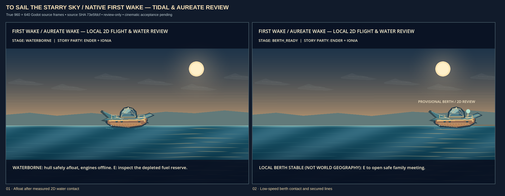
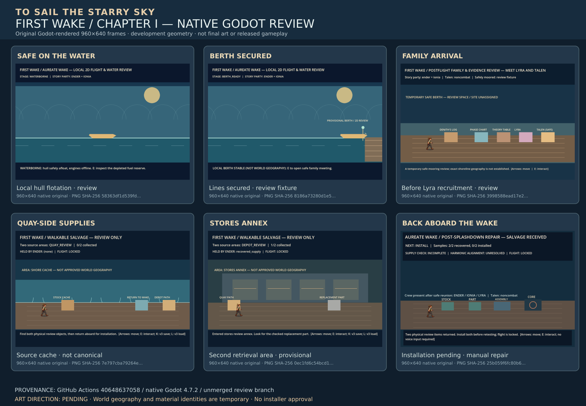
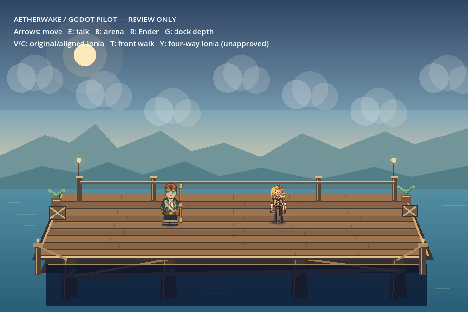
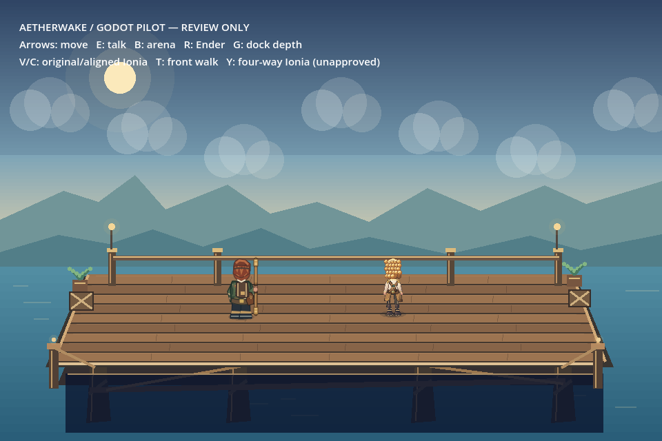
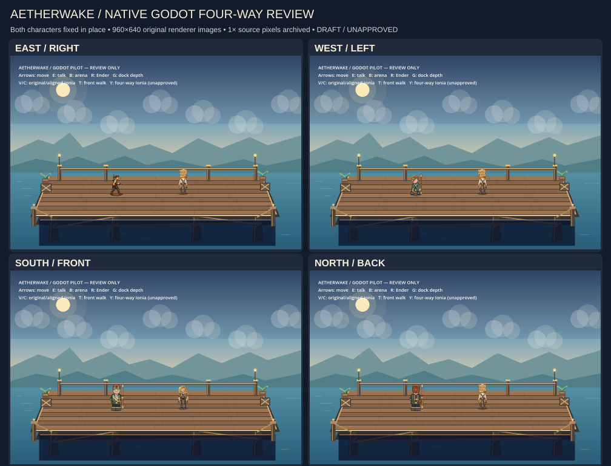
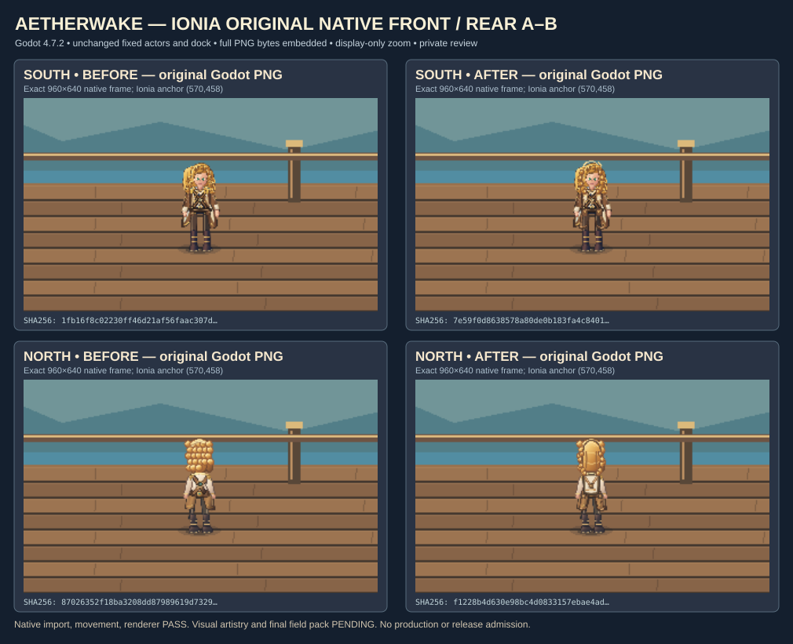
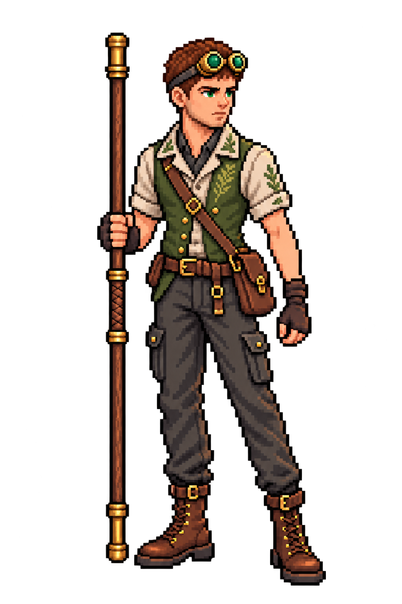

# To Sail the Starry Sky

**An original, character-driven 2.5D science-fantasy JRPG — in active development.** Explore a world of celestial mysteries with five protagonists and the **Aureate Wake**, a ship whose remarkable abilities are discovered gradually through the story. *Aetherwake* is the historical project and prototype name.

**Current playable development target:** the **native Godot 4.7.2 First Wake / Chapter I review** at [`godot/project.godot`](godot/project.godot). The older JavaScript/browser game is maintained as preservation material, **not** the current Godot gameplay, combat or narrative specification.

> **Development review, not a public release.** This README is on the [unmerged visual-gallery draft PR #564](https://github.com/ndrorchestration/ToSailtheStarrySky-jrpg/pull/564). The latest native game is not yet a cleared one-click Windows installer; independent Windows Defender custody/security preflight remains blocked. No game installer is linked or implied to be safe.

## Actual in-engine graphics — development evidence

### Latest playable Aureate Wake and sea material review

**New actual Godot visual upgrade:** hand-layered wood, copper, deck railings and segmented bridge glass on the Aureate Wake; original animated tidal shader, warm horizon glints, depth bands and atmospheric wisps. These are **two genuine native 960×640 game-render screenshots**, from [native capture run #40662836358](https://github.com/ndrorchestration/ToSailtheStarrySky-jrpg/actions/runs/40662836358) on exact visual source `73e5fdcf`. Original source PNGs remain embedded **losslessly** in this SVG. [Implementation, verification and artistic limitations](docs/FIRST_WAKE_TIDAL_AUREATE_VISUAL_PILOT_2026-10-28.md). **Review-only, not final cinematic art or an approved release.**

### Earlier six-frame Chapter I implementation gallery

*Six **genuine lossless 960×640 native Godot 4.7.2 frames**, verified against original PNG SHA-256 receipts and assembled without altering the screenshots. They represent **deterministic development review scenes**, not a finished visual production pass: provisional ship, shore and salvage geometry, dialogue/UI staging and unapproved material identities. [Source capture run](https://github.com/ndrorchestration/ToSailtheStarrySky-jrpg/actions/runs/40648637058) · [Individual frame SHA-256 records](docs/reviews/native-evidence/2026-10-28-first-wake/README.md). These reviewed development frames are published in this draft branch, not in an accepted release.*

### Archived Ender and Ionia directional studies

<table>
  <tr>
    <td width="50%" align="center">
      
       <strong>Ender and Ionia — south-facing native frame</strong>
    </td>
    <td width="50%" align="center">
      
       <strong>Ender and Ionia — east-facing native frame</strong>
    </td>
  </tr>
  <tr>
    <td align="center">
      
       <strong>Ender and Ionia — north-facing native frame</strong>
    </td>
    <td align="center">
      
       <strong>Ender and Ionia — west-facing native frame</strong>
    </td>
  </tr>
</table>

*These are **real, previously committed Godot 960×640 native renderer captures** from the October 21 character-direction review (PR #319), **not** screenshots of the latest Chapter I salvage or save system. They document earlier visual implementation, not approved final character art, a cinematic-quality sign-off, or a released build.*

<strong>More artwork and native character comparisons</strong>

**Four-way character contact sheet — authentic in-engine render study**

**Ionia front/rear cohesion comparison — archived native render study**

**Ender high-resolution art reference — separate from native screenshots; character-art alignment requires review**

**Visual evidence boundary:** The newest two-frame ship/ocean sheet is from the later October 28 visual upgrade; the earlier six-frame Chapter I sheet preserves older pre-upgrade render evidence (including family, quay, depot and workshop) and its own recorded hashes. Independent full-resolution PNG downloads for those six frames are **not** published as separate files; their lossless pixels are embedded in the SVG review graphic. The v3 saving interface is **not pictured**, and no artistic acceptance or playable release is implied. The earlier directional studies below are from October 21. [New ship-and-water native render](https://github.com/ndrorchestration/ToSailtheStarrySky-jrpg/actions/runs/40662836358) · [Chapter I native gameplay regression](https://github.com/ndrorchestration/ToSailtheStarrySky-jrpg/actions/runs/40662836420) · [older six-scene source evidence](https://github.com/ndrorchestration/ToSailtheStarrySky-jrpg/actions/runs/40648637058).

## Open and play the native Chapter I preview

**No installer is required to review the current source in Godot.** Download or clone **this same development branch** and import the project that lives one folder below repository root:

1. [Download the current Godot review branch as ZIP](https://github.com/ndrorchestration/ToSailtheStarrySky-jrpg/archive/refs/heads/docs/readme-native-godot-visual-gallery-20261028.zip), extract it, then install **Godot 4.7.2 Standard (GDScript)**.
2. In **Godot Project Manager**, select **Import** and browse to **`godot/project.godot`** inside the extracted repository folder (not `README.md` or the repository root).
3. In the Godot editor press **F5** to run the configured original Chapter I. **Inside the running game**, press **F8** to open the opt-in revised **Ionia-first** Chapter I route.

| Where | Keyboard control | Behavior |
|---|---|---|
| Original configured Chapter I | **Arrows**, **E** | Move / interact or advance dialogue |
| Original Chapter I | **F5**, **F9** | Original v1 **save** / **load** while the game is running (distinct from Godot editor F5 Run Project) |
| Original or revised story | **F8** | Enter revised review / restore original saved-in-memory scene when returning |
| Revised dock/engineering | **E**, then **F** when preflight is complete | Find Ionia, inspect engineering stations, then enter the bounded 2D flight/water review |
| Revised dock **before** flyer interaction | **J** | Optional resume of a previously saved v3 salvage review; refuses an invalid/missing slot |
| Revised salvage review only | **E**, **K**, **L** | Interact / write separate v3 salvage checkpoint / restore its checkpoint |

The v3 salvage save **does not cover** the workshop, failed engine restart, Denith melody, flight scene or planet-scale ship travel. It does not migrate v1/v2 saves. See the [verified checkpoint scope](docs/FIRST_WAKE_SALVAGE_V3_CHECKPOINT_PILOT.md).

## Chapter I — revised playable story progression

**This is the creator-directed Godot *draft* sequence; the older browser Crossing plot is not the current ordering.**

1. **Ender** is looking for work, finds Captain **Ionia's** flyer and joins her to help repair the Aureate Wake's harmonic-levitation engine.
2. **Ionia joins first**. The crew completes checks and attempts a short flight, but engine phase drift forces a bounded local-physics ocean splashdown and safe berth recovery.
3. **Lyra joins second** after the safe family reunion; her son **Talen remains a noncombat child**. Ender, Ionia and Lyra compare independent clues toward a provisional fuel theory.
4. The player physically retrieves two provisional materials from separate, walkable review areas and returns them to the ship. Manual installation cannot restore the engine: the **restart fails**.
5. Ionia recalls a shanty Denith taught her; Ender and Lyra independently assess a bounded harmonic-alignment idea. This is **bench investigation, not permission to fly**.

The Five Lights and five-protagonist mythology are preserved. **Story Light identities are not automatic combat spells or shared Art unlocks.** Future globe travel, auroral pathways, full sea/submersible/space transformation capabilities and lunar traversal are **narrative/design intentions**, not features demonstrated by these local review scenes.

## Combat, party and Resonance — what is actually implemented

| Layer | Current scope | Not yet authorized or complete |
|---|---|---|
| **Native combat formula contracts** | Ender-oriented **four-action formula subset** ([source](godot/scripts/first_wake_combat_formula.gd)), plus [fail-closed actor/turn authority](godot/scripts/first_wake_party_combat_authority.gd). | The previous browser's **eight-slot action list**, its level unlocks and complete five-character native combat. |
| **Playable encounter study** | Isolated turn-based **Guard → Echo → Strike** telegraph/prediction experiment ([scene model](godot/scripts/vertical_slice_encounter.gd)). | Production encounter roster, universal ability rules or approved combat balance. |
| **Five protagonists / party** | Ender, Ionia, Lyra, Reson and Aepex are the established authored protagonists; the revised Chapter I review recruits Ionia then Lyra. The target is **up to five active protagonists**. | Verified final recruitment and executable combat turns for all five in the Godot game. |
| **Party Resonance** | Proposed Dual/Triple Art definitions, a separate training scene and a composite review preflight ([implementation](godot/scripts/first_wake_resonance_composite_preflight.gd)). | Real story battle execution: the composite returns **`canExecute=false`** and **`canUnlockArt=false`**. |

Nothing in this table defines an approved ability tree, a mandatory character class or final magic economy. Implementation status and design proposals must remain distinct.

## Source, evidence and next quality gates

- **Current implementation/evidence register:** [Godot development status and blockers](docs/CURRENT_GODOT_STATUS_2026-10-28.md).
- **Actual in-engine images:** [new two-frame Aureate Wake / tidal shader render](docs/reviews/native-evidence/2026-10-28-first-wake/aureate-wake-tidal-atmosphere-native-review.svg) plus [earlier six-frame Chapter I gallery with hash receipts](docs/reviews/native-evidence/2026-10-28-first-wake/README.md). Both contain genuine **960×640 Godot renderer outputs**; native correctness and improved silhouettes **do not constitute cinematic art acceptance**.
- **Story/checkpoint:** [v3 separate salvage review contract](docs/FIRST_WAKE_SALVAGE_V3_CHECKPOINT_PILOT.md) · [current vs historical combat/party audit](docs/README_COMBAT_PARTY_STATUS_RECONCILIATION_2026-10-28.md).
- **Visual target:** [Visual Bible](docs/VISUAL_BIBLE.md) · [benchmark scene](docs/VISUAL_BENCHMARK_SCENE.md) · [cinematic integration](docs/CINEMATIC_CLIP_CONTRACT.md). New playable artwork needs source alignment, native render inspection and creator sign-off.
- **Native verification:** [Godot gameplay CI](https://github.com/ndrorchestration/ToSailtheStarrySky-jrpg/actions/runs/40649372371) and [native renderer CI](https://github.com/ndrorchestration/ToSailtheStarrySky-jrpg/actions/runs/40649372369) passed on the prior reviewed exact source. [Browser smoke/docs check](https://github.com/ndrorchestration/ToSailtheStarrySky-jrpg/actions/runs/40652983096) also passed. These runs establish **their own exact heads**, not universal acceptance of future commits.

**Priorities:** make the Aureate Wake, water, weather, dock, Lyra/Talen and environment scenes visually production-worthy **in native Godot**; connect a coherent battle/party vertical slice without fabricating permissions; extend durable progress after salvage; finish independently tested and security-cleared Windows installation.

## Historical browser build — separate archive

The earlier **p5.js / NW.js Aetherwake prototype** still contains its own quests, eight-action combat metadata, level unlock rules, controls, testing commands, and an **October 6, 2026 browser Preview 0.1 Windows artifact**. Those details are deliberately moved out of the current-game README to the [historical browser run/controls and Windows packaging archive](docs/archive/AETHERWAKE_BROWSER_PRESERVATION_README_2026-10-28.md).

The [historical technical specification](SPEC.md) and [early Godot development log](godot/README.md) are not replacements for this current-status summary. Do not present old preview installer artifacts as the current Godot Chapter I download or bypass any Defender warning.

## Credits and provenance

Created by **Andrew Hensel** ([ndrorchestration](https://github.com/ndrorchestration)). The game is developing its own characters, world, gameplay, original art and narrative; historical technical adaptation and references are documented in [the provenance catalog](memories_adaptation_catalog.md).
