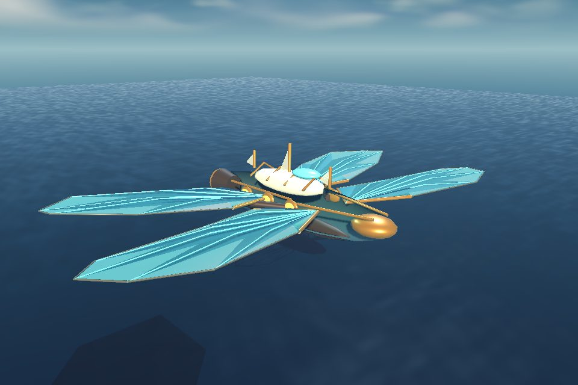
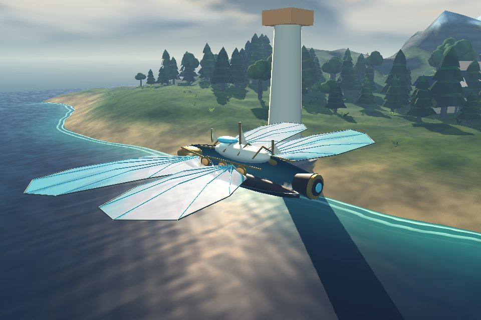
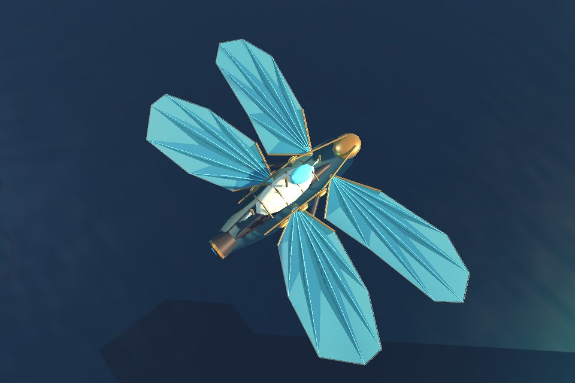
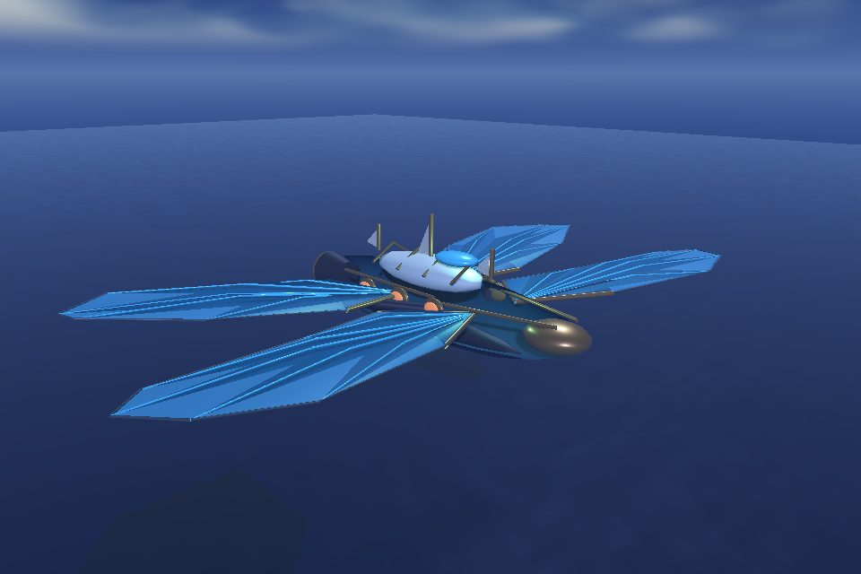
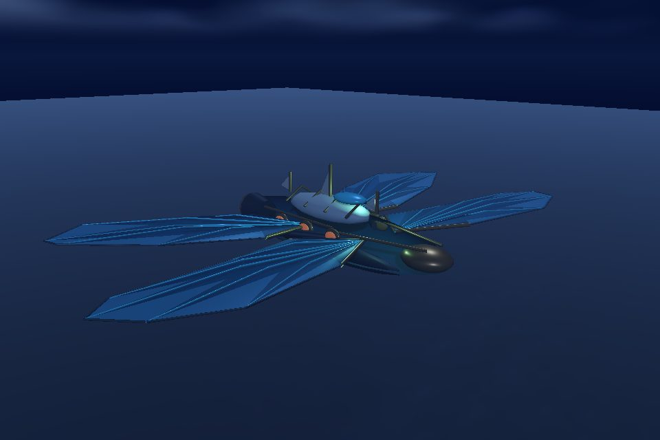
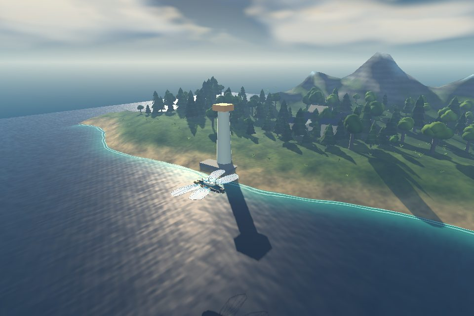
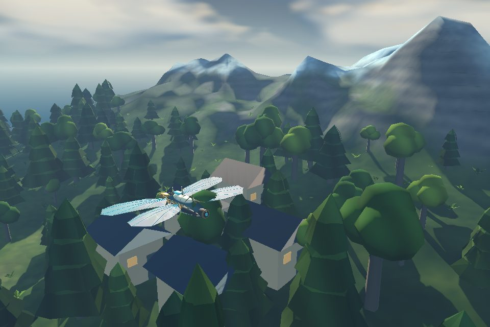
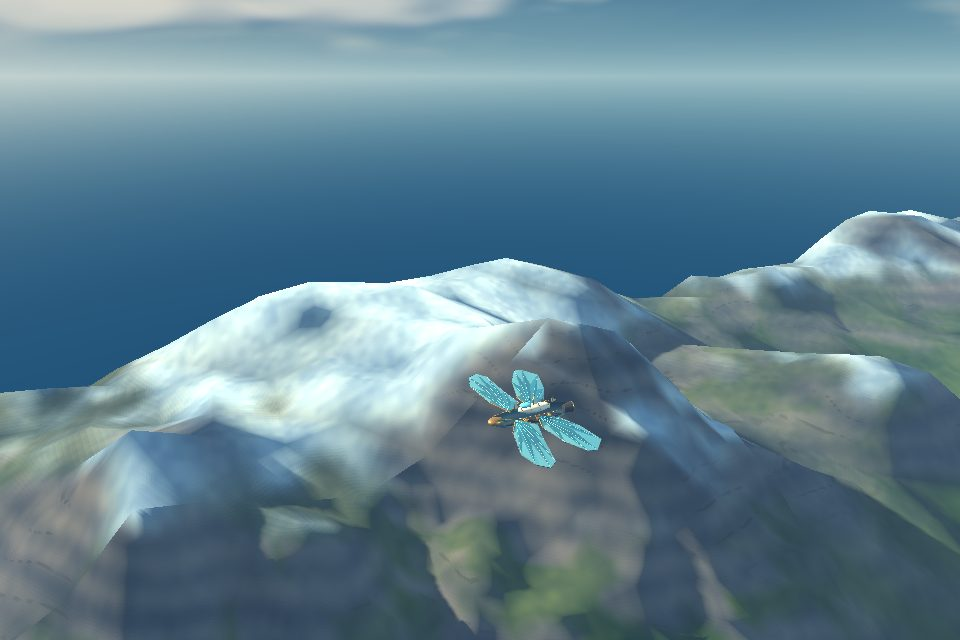
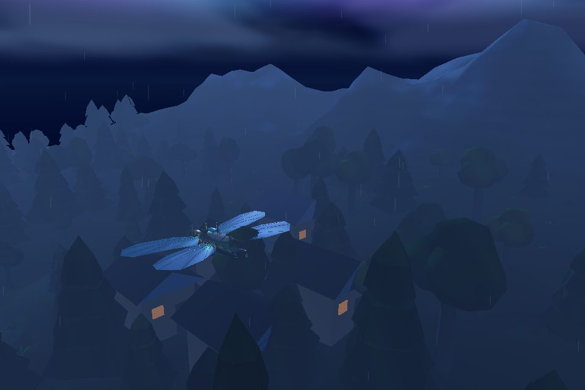
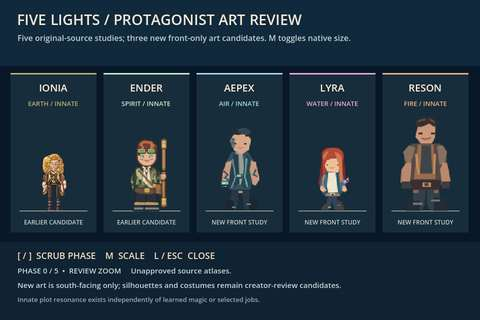

# Native Godot visual development gallery — October 27, 2026

> **EXPERIMENTAL / REVIEW ONLY — NOT APPROVED ART OR A RELEASE.** Every image below is derived from an actual native Godot 4.7.2 rendering, not synthesized concept art. The screenshots come from **separate unmerged candidate branches** and should **not** be represented as one integrated playable build or approved visual baseline.

[Back to main README](../README.md) · [Visual bible](VISUAL_BIBLE.md) · [World/ship direction](WORLD_SHIP_VISUAL_DIRECTION.md) · [Character art authority](CHARACTER_AND_ART_AUTHORITY.md)

## Aureate Wake — hero silhouette and weather

The ship below is the **compact Aureate Wake**, not the larger, separate Dragonfly Frigate. Original procedural/native GDScript proposal in the experimental **combined ship + weather** branch, [draft PR #422](https://github.com/ndrorchestration/ToSailtheStarrySky-jrpg/pull/422) at `0ba35e6bd4e6acd4c5b7e880be1758d17feebab6`. This particular combined branch **does not automatically include later, independently stacked #419 geometry refinements**.

### Bow-quarter

### Stern-quarter and overhead

### Same-ship atmospheric variations

These images test camera angle, original wing/rig proposal, sky, fog and weather. Visual legibility, transparent-wing sorting, target hardware and creator artistic acceptance remain open.

## Terrain and biomes — native software-GL study

Captured from the **same #422 combined experimental run**, showing sample coast–forest–highland shots. Terrain rendering and contact tests do not certify a finished spherical world map, planetary navigation or final biome art.

### Coast at dusk

### Golden-hour forest

### Highland horizon

### Magical atmosphere

## Five Lights character lineup — *separate* native review branch

From [draft PR #421](https://github.com/ndrorchestration/ToSailtheStarrySky-jrpg/pull/421), exact head `3ddd36b2c3b46ae7546da60e732905e665773fd9`. This **480×320 JPEG** is the bounded real native Godot renderer thumbnail embedded in the [capture-job log](https://github.com/ndrorchestration/ToSailtheStarrySky-jrpg/actions/runs/40577322365), derived from an original 960×640 captured scene. It is **not** the unreleased full-resolution character framebuffer. These are unapproved candidate sprites; the game-specific character art and animations still need further development and creator review.

## Source custody and verification

| Evidence | Exact origin | Readiness meaning |
| --- | --- | --- |
| Ship / terrain / sky images | [Godot native CI run 40578319950](https://github.com/ndrorchestration/ToSailtheStarrySky-jrpg/actions/runs/40578319950), [original 960×640 PNG capture artifact 12768611791](https://github.com/ndrorchestration/ToSailtheStarrySky-jrpg/actions/runs/40578319950/artifacts/12768611791), [draft #422](https://github.com/ndrorchestration/ToSailtheStarrySky-jrpg/pull/422) | Native experimental run PASS; original frames retained below as PNG, README JPEGs are optimized derivatives |
| Five Lights lineup | [Godot native capture CI run 40577322365](https://github.com/ndrorchestration/ToSailtheStarrySky-jrpg/actions/runs/40577322365), [draft #421](https://github.com/ndrorchestration/ToSailtheStarrySky-jrpg/pull/421) | Captured engine preview only; not accepted appearance or production animation |
| Publishing | **This documentation-only branch** | No gameplay code, canon, merge, executable package, or release authorization |

The accompanying [image provenance manifest](screenshots/native-2026-10-27/provenance.json) records the input PNG and output JPEG SHA-256 values. Full original-resolution **PNG captures** are preserved under [original/](screenshots/native-2026-10-27/original/) for ship and terrain images. The character lineup is preserved at the bounded JPEG preview resolution because the separate full-size image was not published as a reusable artifact.

## Review gates still open

- Creator accepts/rejects individual visuals, including ship identity, silhouette, wing transparency and proportion.
- Target Windows GPU validation, representative frame-time and VRAM profiling, accessibility/reduced-motion visual review.
- Character four-direction completeness, costume/gait/pose quality, approved source-asset provenance.
- Cross-branch integration, Godot gameplay/save/quest parity, player acceptance and any merge/release decision.

**Not a claim of completed cinematic visuals.** To update this gallery, use **new native Godot frames**, preserve exact run and source SHA, and separately record creator aesthetic approval.
