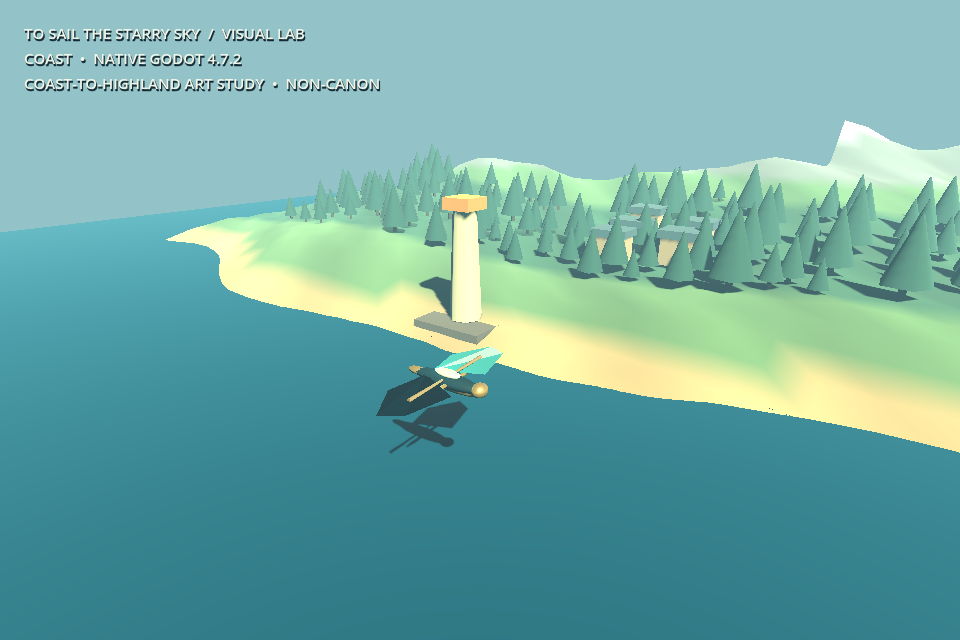
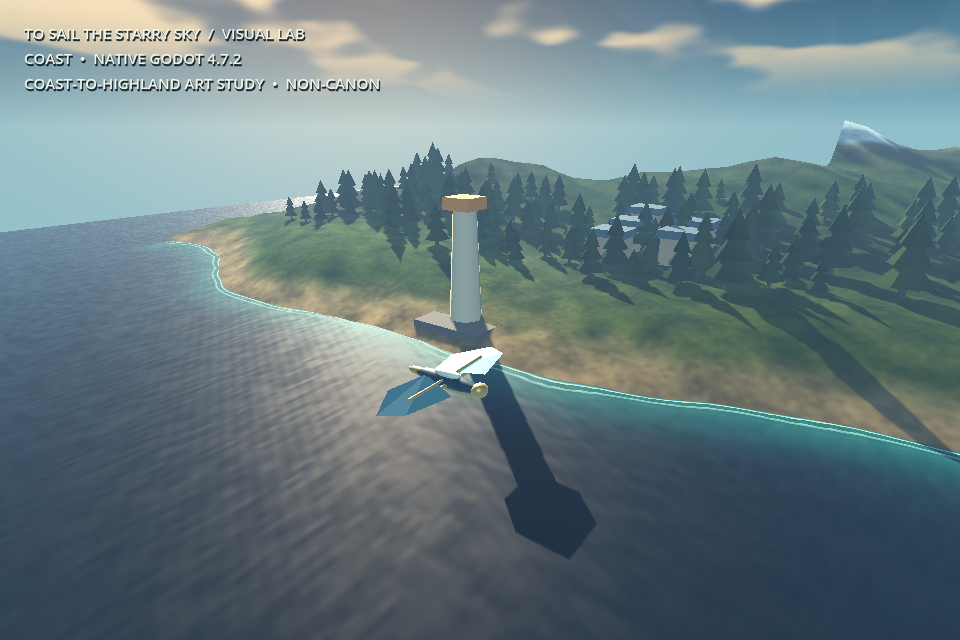
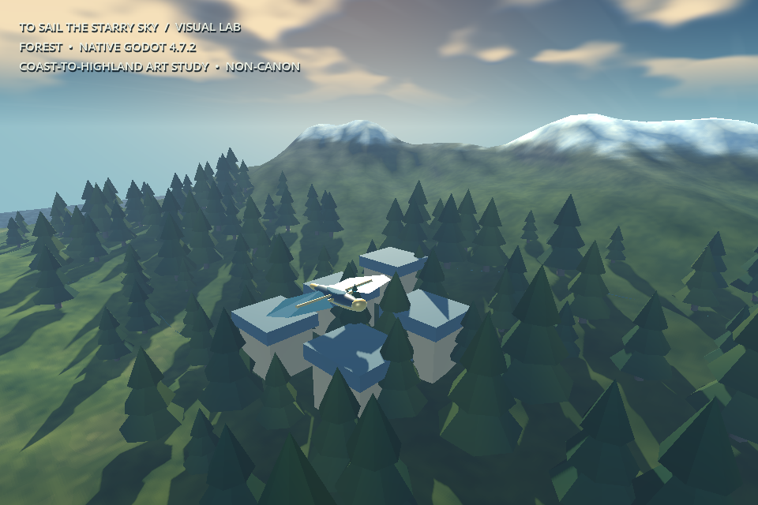
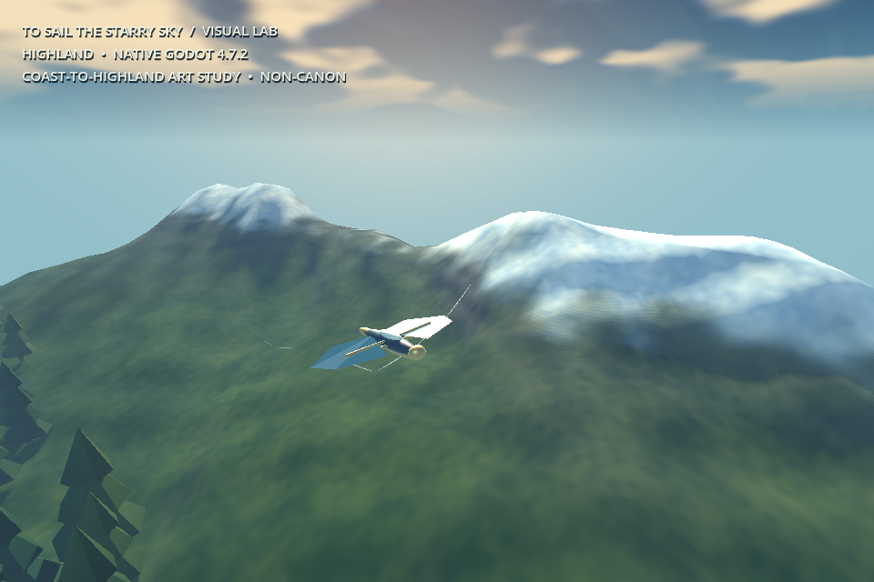

# Flight atmosphere and material study — 2026-10-25

**Disposition: isolated native art study; visual release gate remains OPEN.** This improves PR #370's existing local coast-to-highland flyover. It is not a C# product port, seamless planetary world or approved Dragonfly asset. No merge, release, default main-scene switch, save migration or creator visual approval.

## Provenance

Base: PR #370 `221d102bc5ac3270083d25af14ce71089db72571`. Reviewed material implementation: `da8b51a001703610319ab135e34257a7ac456b0d`; final shoreline fix: `9634e9c`; headless/real-render coverage tests: `3557d3d76d49b06f83fe443512d8ecf1343a8cf2`. Runtime material files did not change after the shoreline fix. Final still captures and native test logs include the final coverage readback test.

Source manifest SHA-256: `e96a3f064b9ffc9b83d00c056bf25f18f534c77d1a73ac358407cf5710388c21` over 16 code/project files; see [manifest](media/flight-atmosphere-20261025/source-manifest.json).

Fresh checks found #349 `0be2cb77…`, #363 `0362fad5…`, and #370 `221d102b…` still draft and unmerged. #367's spherical terrain study, #368's C# contracts, private v0.8.0 celestial navigation and the unpublished laptop lane remain intact. This pass changes neither celestial activation nor discovery restrictions; their earlier tests are not claimed as newly rerun here.

## What changed

A separate presentation adapter installs a warm horizon/cool sky, layered procedural clouds, restrained terrain cloud shading, terrain-depth water with animated normals/foam, slope/height material bands, and layered conifer crowns. The terrain sampler, tile generation and LOD rules, auto-flight path and ship source are unchanged. The shore field uses the actual terrain sampler and an 8×8 live tile coverage mask so foam cannot extend onto terrain that is not rendered.

P holds route/effect clocks (the inherited follow camera can settle briefly), M holds effect/ship oscillation at a reference state while flight continues, V changes shader detail, and H hides the overlay. `--baseline` retains the original presentation for matched poses. No imported/generated bitmap art or third-party assets.

## Actual native evidence

Official Godot **4.7.2.stable.official.ed1daf0bf**, Linux, Compatibility/OpenGL 4.5, Mesa 25.2.8 llvmpipe LLVM 20.1.2, **960×640**. These PNGs are untouched native framebuffer captures. The sky uses procedural layers, not volumetric scattering; material detail is procedural, not approved pixel-authored art.

| Matched coast before | Matched coast after |
|---|---|
|  |  |

The owner package also contains all three before/after pairs, a low-detail frame, full logs and a **24-second, 720-frame, 30-Hz native Movie Maker flyover**. MP4 is transcoded from the engine AVI without retouching. Fixed-step encoded smoothness is not evidence of real-time speed. The movie took about 39 seconds to render on this host. It is an automatic flyover, not manual piloting footage.

## Verification

- Original native terrain/LOD/ship suite: **94 checks PASS**.
- Presentation suite: PASS for explicit clocks, pause clock, reduced-motion clocks, quality toggles, retained geometry budget, sampled depth field, outward crown winding and hidden/live tile masks.
- Actual GL compile/capture: PASS. Shader motion changed **63,303 sampled pixels**; frozen state and reduced motion each changed **zero**; low detail changed **47,375**. Counts exclude the HUD and sample every second pixel; these are behavior checks, not artistic scores.
- Real GL texture readback: PASS after hiding every terrain tile; coverage is zero. The dummy headless renderer retained stale texture readback, so its test checks the CPU mask while GL separately checks the real resource.
- All saved PNG dimensions and writes checked. Profile JSONs independently parsed. Video stream/frame count checked separately.
- A fresh reviewer inspected the source and all six matched images. Their important finding—a floating foam line beyond the finite terrain—was reproduced, corrected with visible-tile coverage, regression-tested and visually rechecked. No second review is claimed.
- Hosted exact-head checks are separate from these local receipts; consult the draft PR checks for their current state.

## Software-host observations

20 warmup frames and 120 wall-clock intervals per fixed view/setting, between completed frame callbacks. Effects animate; route/camera are held for comparison. Single sequential runs, shared software host, unsupported VSync. Numbers are **milliseconds, median / p95**, not hardware GPU timestamps, target FPS, VRAM or statistical performance guarantees.

| View | Baseline median / p95 | High median / p95 | Low median / p95 |
|---|---:|---:|---:|
| Coast | 42.05 / 54.56 | 41.34 / 47.57 | 42.82 / 50.90 |
| Forest | 43.94 / 53.00 | 42.56 / 47.62 | 44.33 / 53.47 |
| Highland | 34.28 / 41.02 | 34.95 / 41.61 | 35.60 / 43.15 |

High-detail cost is similar to baseline in this sample. Low detail shows **no consistent measured advantage** and remains an experimental knob. Draw calls are also influenced by the changed light/shadow visibility. Raw measurements are in the owner package; [summary](media/flight-atmosphere-20261025/software-observations.json).

## Visual judgment and next priorities

Observed improvement: readable sky/horizon depth, differentiated water/sand/soil/rock/snow, quieter highlights after iteration, and richer tree silhouettes. Independent review agreed this is an improved material study. It does **not** yet meet the user's visually exceptional JRPG target.

1. **Art and composition:** replace repeated tree masses, box roofs and ship proxy with creator-approved silhouettes/materials. Recompose the forest so the hamlet and ship do not overlap. Acceptance: distinctive scene identity and clear ship/biome reading at native 960×640 without the HUD.
2. **Surface and atmosphere:** break the thin parallel surf contours, improve ridge forms and replace broad cloud patches with art-directed layers. Preserve pixel-art coherence and test temporal aliasing/LOD transitions in continuous footage. Acceptance: no obvious procedural repetition, distracting popping or mismatched pixel density.
3. **Integration and target performance:** under the separate C# product decision, bind the approved material work to the spherical terrain/navigation implementation, then profile actual Windows GPU/Forward+ and verify local-to-planet transitions. No production port is assumed here.

## Decisions and remaining limits

- Continued #370's isolated GDScript art study to avoid duplicating terrain/streaming or overriding C# product work. Cost if unsuitable: replace the thin adapter in the chosen product project.
- Kept the original presentation as a temporary `--baseline` fixture for direct comparison. Cost: a small review-only setup branch remains.
- Creator acceptance, canonical Dragonfly, planetary continuity, private route behavior, C# integration and Windows GPU validation stay unapproved/unverified by this revision. Cost: integration or art may require substantial rework.
- Preserved inherited camera easing after pause, documented above. Cost: pause is not an instantaneous camera freeze.

Deferred minor harness hardening: check profile-file errors after flush (delivered JSON was parsed successfully), and validate null/dimensions for every intermediate comparison frame (saved stills are already guarded). These are known failure-path limits; neither affected the successful delivered evidence. Inherited finite terrain, planar coordinates, automatic movement, no collisions/landing and simple landmarks remain explicit.
