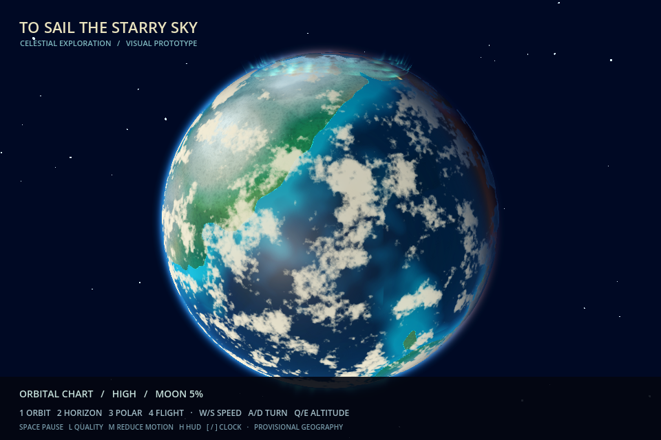

# Native planetary render evidence — 2026-10-25

Actual Godot 4.7.2 Compatibility rendering now demonstrates the planetary study at **960×640**. The orbital view improves atmosphere, cloud depth and ocean/land separation. **It does not yet meet the premium JRPG visual release requirement.** Flight-scale detail, authored 2.5D presentation, target-hardware profiling and creator acceptance remain open.

This is a documentation/evidence draft stacked on #349. No native runtime source is admitted by this PR. The full standalone project, tests, capture runner and studio footage are in an owner-delivered private archive so unreleased development content is not added to the public source tree. No Chapter I/save/canon changes, merge, release, public deployment or creator approval.

## Exact scope and continuity

- #349 inspected/refreshed at `0be2cb77fe9fee27717c7ad5ae7847a7feb68043`, still draft; geometry, cartography, tile metadata and in-memory cache are preserved.
- #363 inspected/refreshed at `0362fad575367dad9eb47836410cf39a2eed3f67`, still draft; its independent browser study is preserved. Native evidence here does not retroactively validate its Canvas art.
- Existing v0.7.5 native planetarium, original textures, Dragonfly proxy, local diorama and flight math are retained. The new standalone scene extends that native source. Original archives remain immutable.
- Candidate source manifest SHA-256: `6005c119db085d0bdc98ea39baa67f8ed8a9ea6115f0aa0a105a0a259983c72d` (42 files). This identifies the reviewed source, not an approval.
- Engine: `4.7.2.stable.official.ed1daf0bf`; Linux OpenGL Compatibility, Mesa llvmpipe software rendering. Capture: 2026-10-25. No generated illustrations or browser renders are presented as native frames.

## Actual native views

[Curved horizon](media/native-planetary-20261025/view_2.png) · [Polar lights](media/native-planetary-20261025/view_3.png) · [Flight](media/native-planetary-20261025/view_4.png) · [Low-quality orbital comparison](media/native-planetary-20261025/low_quality.png)

High/low orbital captures use matching celestial time, animation clock, camera and viewport. The low setting halves cloud samples (12→6) and keeps two of six ordinary curtain meshes. It does not change navigation truth. Geographic textures are inherited provisional art, not approved continents/biomes.

## Verification and limits

Native import, five GDScript suites and the graphical capture runner passed. The navigation suite contains 2,057 assertions; native scene tests dispatch actual keyboard InputEvents. Inherited Node foundation tests pass **38/38**. PNGs were decoded and checked for dimensions, distinct hashes and source identity. A separate read-only agent reviewed navigation/pause behavior and comparison setup; identified findings were reproduced, repaired and rechecked. This is code review, not artistic approval.

The source runner creates a fresh output directory for each run, checks its manifest and engine version, rejects compiler/shader failures and records renderer/frame data. The private 20-second movie contains 600 native frames at fixed 30 Hz; its playback rate is **not** realtime-performance evidence. No Windows or Forward+ claim is made.

## Software-host observations

32 measured frame intervals per view after three warm-up frames, including actual render completion; rendering instrumentation and shared host load are not isolated. These small samples are diagnostic observations, not target-GPU benchmarks. High/low comparisons cannot establish a reliable optimization percentage from this run.

| Scene | Median ms | P95 ms | Draw calls |
|---|---:|---:|---:|
| Orbital, high | 378.06 | 772.94 | 24 |
| Orbital, low | 360.60 | 644.55 | 20 |
| Horizon | 176.99 | 376.74 | 17 |
| Polar | 340.49 | 694.33 | 22 |
| Flight | 220.28 | 4087.08 | 78 |

Renderer-reported allocation was about 63.4 MiB for these views; this is not dedicated VRAM measurement. The flight P95 includes a multi-second stall. Frame-rate acceptance is **not met or established** on this host. Raw safe-view observations: [JSON](media/native-planetary-20261025/software-frame-observations.json).

## Independent visual assessment

The actual globe has readable curvature, layered light and broad land/ocean contrast. Polar curtains are visible but remain uniform procedural forms. Flight views have weak terrain detail and sparse scale cues. Horizon framing leaves too much empty sky. The ship is an inherited geometry proxy; filtered surfaces and that proxy do not yet form the desired authored 2.5D pixel-art language. Animation is present, but presentation still needs art-directed pacing and sound. Passing tests does not resolve these visual findings.

## Prioritized next pass

1. Author one coherent coast-to-highland flight slice with readable biome silhouettes, inhabited landmarks and actual mesh LOD/streaming linked to #349's addressing contract. Evaluate continuity and readability at 960×640.
2. Refine the approved ship presentation, materials, horizon composition, weather and celestial staging; compare matched native footage and obtain separate creator visual review.
3. Profile the exact manifest on the Windows target in Compatibility and Forward+, using at least 1,000 warmed frames per representative scene and an explicit frame/memory budget before optimizing/admitting runtime source.

**Status: draft evidence checkpoint; visual release gate open.**
